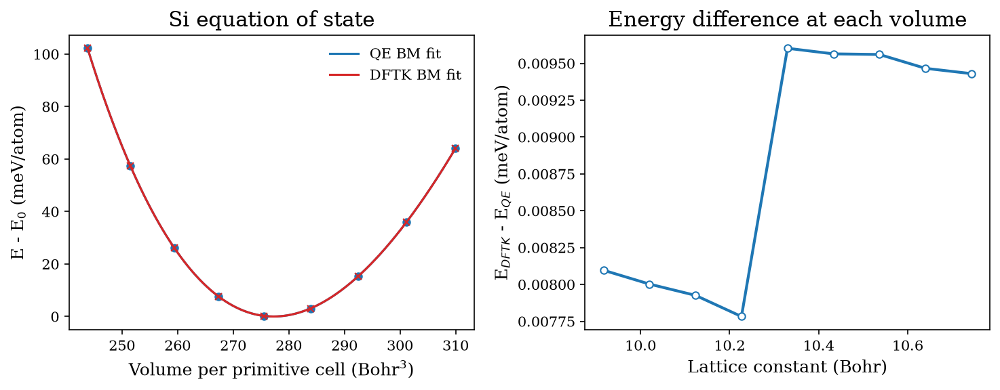
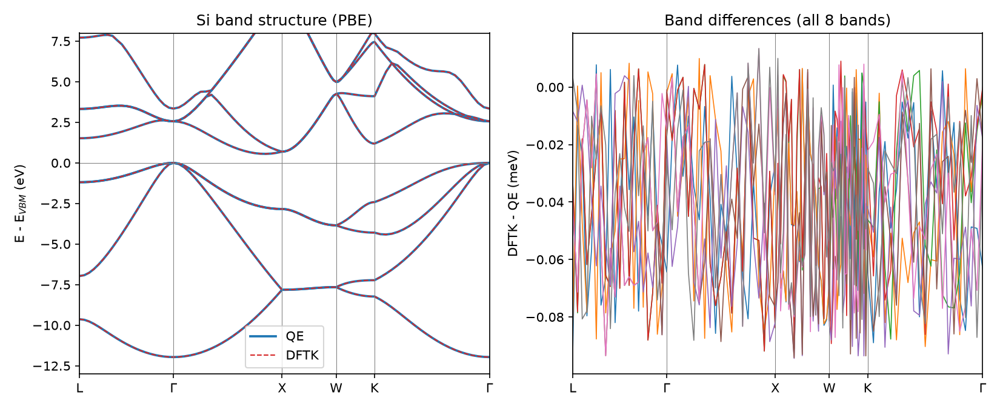

# qe-vs-dftk

Reproducible comparison of [Quantum ESPRESSO](https://www.quantum-espresso.org/) (QE)
and [DFTK.jl](https://github.com/JuliaMolSim/DFTK.jl) on identical plane-wave DFT calculations.

The goal is to verify that both codes give the same answers under the same settings,
and to help people who do not have QE installed try simple DFT simulations with DFTK.

## Quick start

Requirements: QE (`pw.x`, MPI), Julia, Python 3.9+.

```bash
git clone https://github.com/otnielxs/qe-vs-dftk.git
cd qe-vs-dftk
julia --project=. -e 'using Pkg; Pkg.instantiate()'
python -m pip install -e ".[dev]"
./scripts/run_si.sh
./scripts/run_si_eos.sh
./scripts/run_si_bands.sh
```

## Stage 1: bulk silicon

| Setting | QE | DFTK |
|---|---|---|
| Functional | PBE | PBE |
| Pseudopotential | ONCV (SG15) | same file |
| Cutoff | 60 Ry | 30 Ha |
| k-grid | 6x6x6, Gamma-centered | 6x6x6 |
| Smearing | Marzari-Vanderbilt, 0.2 Ry | Marzari-Vanderbilt, 0.1 Ha |

Results (QE 7.5 vs DFTK 0.8.0):

| Quantity | Difference (DFTK - QE) |
|---|---|
| Total energy | +0.0046 meV/atom |
| Gamma eigenvalues relative to VBM (8 bands) | all within 0.04 meV |

## Stage 2: equation of state of bulk silicon

9 lattice constants (10.33 Bohr ±4%), fixed occupations, 60 Ry / 30 Ha cutoff,
8x8x8 k-grid, same ONCV pseudopotential. Third-order Birch-Murnaghan fit.
Run with `./scripts/run_si_eos.sh`.

| | a0 (Å) | B0 (GPa) | B0' |
|---|---|---|---|
| QE 7.5 | 5.4777 | 87.37 | 4.25 |
| DFTK 0.8.0 | 5.4777 | 87.37 | 4.25 |



The two codes agree to 3e-6 Å in a0 and 0.0004 GPa in B0. The largest energy
difference over all volumes is 0.01 meV/atom. The Birch-Murnaghan fit residual
(0.027 meV/atom) is the same for both codes, so it comes from the fit model and
not from the codes.

For reference, PBE literature values for Si are about 5.47 Å and 88-89 GPa;
experiment gives about 5.43 Å and 99 GPa. PBE is known to overestimate the
lattice constant and underestimate the bulk modulus.

## Stage 3: band structure and band gap of silicon

Same structure and settings as above (a = 10.26 Bohr, fixed occupations, 60 Ry / 30 Ha),
band structure along L-Γ-X-W-K-Γ with 101 identical k-points in both codes.
The path is given in Cartesian coordinates (units of 2π/a), so it means the same
in both codes even though their primitive cells are chosen differently.
Run with `./scripts/run_si_bands.sh`.

| | Indirect gap (eV) | Direct gap at Γ (eV) |
|---|---|---|
| QE 7.5 | 0.5549 | 2.5602 |
| DFTK 0.8.0 | 0.5548 | 2.5602 |



Bands are aligned at the valence band maximum of each code, because absolute
eigenvalues are not comparable between codes. The largest difference over all
8 bands and 101 k-points is 0.094 meV. QE prints eigenvalues with 4 decimals, so
differences of about 0.1 meV are rounding noise. As expected, PBE underestimates
the experimental indirect gap (1.17 eV).

### Notes

- Absolute Fermi levels differ (about 0.9 eV) because the zero of the electrostatic
  potential is defined differently in each code. Only energy differences are
  physically meaningful, so this repo compares eigenvalues relative to the VBM.
- SCF iteration counts are not comparable: the mixing schemes and convergence
  criteria are different.
- Both codes use the same pseudopotential, so this verifies the implementations,
  not the accuracy of the physics.

## Roadmap

- [x] Stage 1: Si total energy and Gamma eigenvalues
- [x] Stage 2: E-V curve (lattice constant, bulk modulus)
- [x] Stage 3: band structure and band gap
- [ ] Stage 4: metal (Al) and smearing
- [ ] Stage 5: convergence and timing
- [ ] Stage 6: MoS2 monolayer

## Versions and credits

QE 7.5, DFTK 0.8.0
Pseudopotential: SG15 ONCV
