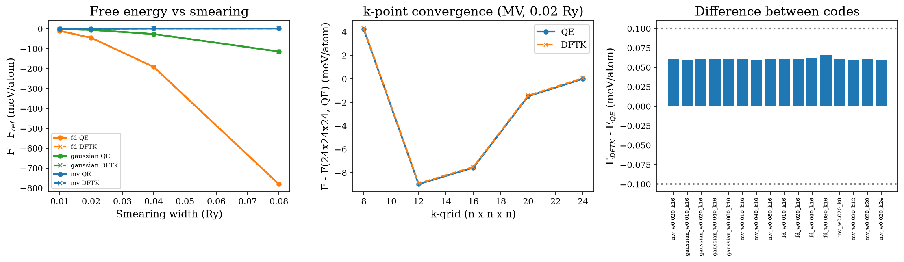
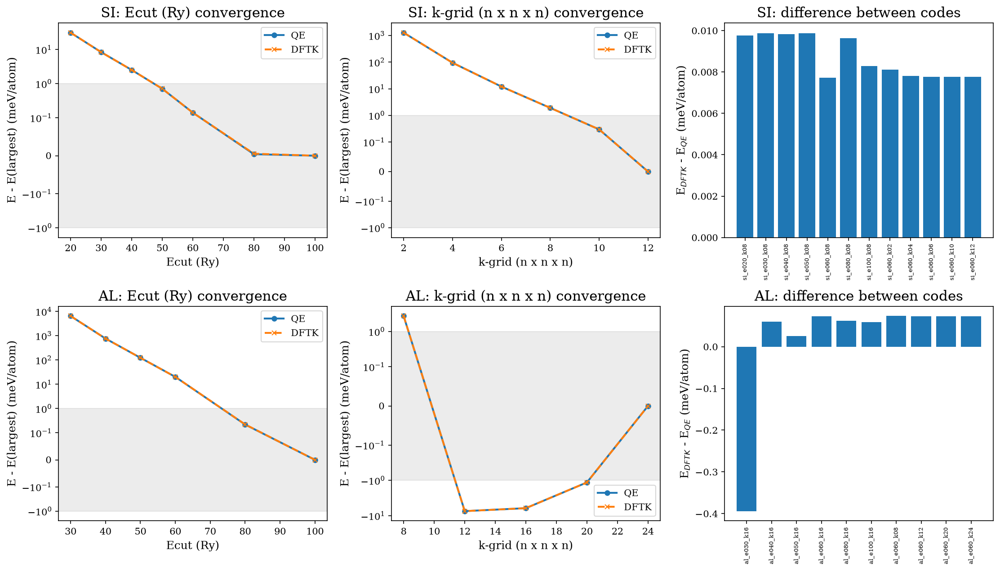
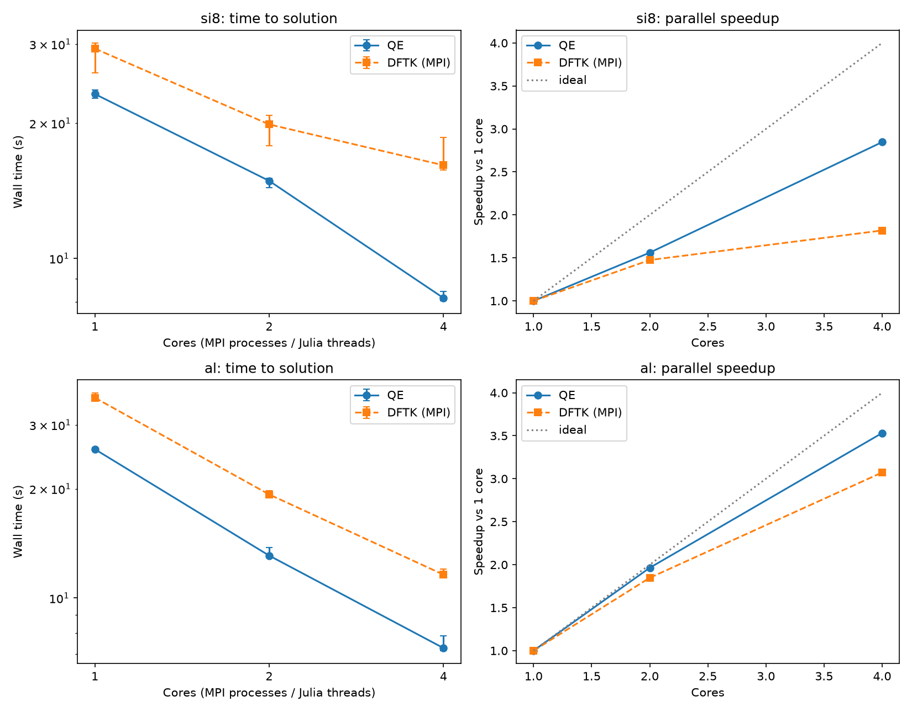

# qe-vs-dftk

Reproducible comparison of [Quantum ESPRESSO](https://www.quantum-espresso.org/) (QE)
and [DFTK.jl](https://github.com/JuliaMolSim/DFTK.jl) on identical plane-wave DFT calculations.

The goal is to verify that both codes give the same answers under the same settings,
and to help people who do not have QE installed try simple DFT simulations with DFTK.

## Key findings

- Same pseudopotential, same settings: QE 7.5 and DFTK 0.8.0 agree to 0.005 meV/atom (Si total energy),
  3e-6 Å and 0.0004 GPa (Si lattice constant and bulk modulus), and 0.07 meV (Si band structure and gap).
- Aluminum (smearing, k-points): agreement within 0.066 meV/atom (see Stage 4).
- Convergence: Si needs 50 Ry (1 meV/atom), Al needs 80 Ry (semicore states).
- Timing (one laptop): DFTK needs 1.3-1.4x the single-core time of QE on two small workloads.

## Quick start

Requirements: QE (`pw.x`, MPI), Julia, Python 3.9+.

```bash
git clone https://github.com/otnielxs/qe-vs-dftk.git
cd qe-vs-dftk
julia --project=. -e 'using Pkg; Pkg.instantiate()'
python -m pip install -e ".[dev]"
./scripts/run_si.sh
./scripts/run_si_eos.sh
./scripts/run_si_bands.sh
./scripts/run_al.sh
julia --project=. -e 'using MPI; MPI.install_mpiexecjl()'
./scripts/run_convergence.sh
./scripts/run_timing.sh
```

## Stage 1: bulk silicon

| Setting | QE | DFTK |
|---|---|---|
| Functional | PBE | PBE |
| Pseudopotential | ONCV (SG15) | same file |
| Cutoff | 60 Ry | 30 Ha |
| k-grid | 6x6x6, Gamma-centered | 6x6x6 |
| Smearing | Marzari-Vanderbilt, 0.2 Ry | Marzari-Vanderbilt, 0.1 Ha |

Results (QE 7.5 vs DFTK 0.8.0):

| Quantity | Difference (DFTK - QE) |
|---|---|
| Total energy | +0.0046 meV/atom |
| Gamma eigenvalues relative to VBM (8 bands) | all within 0.04 meV |

## Stage 2: equation of state of bulk silicon

9 lattice constants (10.33 Bohr ±4%), fixed occupations, 60 Ry / 30 Ha cutoff,
8x8x8 k-grid, same ONCV pseudopotential. Third-order Birch-Murnaghan fit.
Run with `./scripts/run_si_eos.sh`.

| | a0 (Å) | B0 (GPa) | B0' |
|---|---|---|---|
| QE 7.5 | 5.4777 | 87.37 | 4.25 |
| DFTK 0.8.0 | 5.4777 | 87.37 | 4.25 |


The two codes agree to 3e-6 Å in a0 and 0.0004 GPa in B0. The largest energy
difference over all volumes is 0.01 meV/atom. The Birch-Murnaghan fit residual
(0.027 meV/atom) is the same for both codes, so it comes from the fit model and
not from the codes.

For reference, PBE literature values for Si are about 5.47 Å and 88-89 GPa;
experiment gives about 5.43 Å and 99 GPa. PBE is known to overestimate the
lattice constant and underestimate the bulk modulus.

## Stage 3: band structure and band gap of silicon

Same structure and settings as above (a = 10.26 Bohr, fixed occupations, 60 Ry / 30 Ha),
band structure along L-Γ-X-W-K-Γ with 101 identical k-points in both codes.
The path is given in Cartesian coordinates (units of 2π/a), so it means the same
in both codes even though their primitive cells are chosen differently.
Run with `./scripts/run_si_bands.sh`.

| | Indirect gap (eV) | Direct gap at Γ (eV) |
|---|---|---|
| QE 7.5 | 0.5549 | 2.5602 |
| DFTK 0.8.0 | 0.5548 | 2.5602 |


Bands are aligned at the valence band maximum of each code, because absolute
eigenvalues are not comparable between codes. The largest difference over all
8 bands and 101 k-points is 0.094 meV. QE prints eigenvalues with 4 decimals, so
differences of about 0.1 meV are rounding noise. As expected, PBE underestimates
the experimental indirect gap (1.17 eV).

## Stage 4: aluminum (metal) and smearing

fcc Al, a = 7.65 Bohr, ONCV pseudopotential (SG15), 40 Ry / 20 Ha cutoff.
Run with `./scripts/run_al.sh`. 16 cases: three smearing types (Gaussian,
Marzari-Vanderbilt, Fermi-Dirac) at four widths on a 16x16x16 grid, and a k-grid
scan from 8x8x8 to 24x24x24. QE `degauss` (Ry) corresponds to DFTK `temperature` temperature (Ha) = degauss (Ry) / 2



| Quantity | Result |
|---|---|
| Max free-energy difference over all cases | 0.066 meV/atom |
| Max difference in bandwidth (εF - ε1(Γ)) | 0.085 meV |
| Bandwidth (QE, MV 0.02 Ry, 16x16x16) | 11.1651 eV |

Notes:
- The Fermi level itself is not comparable between codes, so the occupied
  bandwidth is used instead.
- Marzari-Vanderbilt (cold) smearing gives a free energy that depends weakly on
  the width, while Gaussian and Fermi-Dirac depend strongly on it.
- Metals need dense k-grids: the energy changes by ... meV/atom between 8x8x8 and 24x24x24.

## Stage 5: convergence and timing

### Convergence

Ecut scans (at the base k-grid) and k-grid scans (at 60 Ry) for Si and Al in both codes
(`./scripts/run_convergence.sh`). Energies are compared with the largest value of each scan,
so "not reached" means the scan range was not wide enough to show convergence.



| System | Ecut for 1 meV/atom | Ecut for 0.1 meV/atom | k-grid for 1 meV/atom | k-grid for 0.1 meV/atom |
|---|---|---|---|---|
| Si (scans: 20-100 Ry, k 2-12) | 50 Ry | 80 Ry | 10x10x10 | not reached |
| Al (scans: 30-100 Ry, k 8-24) | 80 Ry | not reached | not reached | not reached |

- Al has semicore states and needs a much higher cutoff than Si. The Stage 4 results
  (40 Ry) and the base setting (60 Ry) are therefore not converged for Al in absolute terms.
  They are still valid for comparing the codes, since both use identical settings.
- The Si calculations in Stages 1-3 use an 8x8x8 grid, which is not converged to 1 meV/atom
  (10x10x10 is needed).
- QE and DFTK agree at every point of every scan: below 0.025 meV/atom for all Si cases and
  at most 0.074 meV/atom for Al with Ecut >= 40 Ry. The largest difference is 0.394 meV/atom,
  at the lowest Al cutoff (30 Ry), where the basis is far from converged.

### Timing

Time to solution for the same calculation on 1, 2 and 4 cores (`./scripts/run_timing.sh`).
Machine: Intel Core i5-13450HX (16 logical cores), WSL2. QE 7.5: `mpirun -np N pw.x -nk N`
(k-point pools). DFTK 0.8.0 (Julia 1.11.1): MPI over k-points, one Julia thread and one BLAS
thread per rank. Median of 3 runs, after a warm-up run for DFTK (no compilation time).
Tolerances: QE `conv_thr` = 1e-10 Ry, DFTK `tol` = 1e-6 (these measure different things;
both reach the same energy to within 0.073 meV/atom).



| Workload | Cores | QE (s) | DFTK (s) | DFTK / QE | QE speedup | DFTK speedup |
|---|---|---|---|---|---|---|
| Si, 8 atoms (4x4x4) | 1 | 23.23 | 29.32 | 1.26 | 1.00 | 1.00 |
| | 2 | 14.88 | 19.88 | 1.34 | 1.56 | 1.48 |
| | 4 | 8.16 | 16.12 | 1.98 | 2.85 | 1.82 |
| Al (24x24x24) | 1 | 25.71 | 35.64 | 1.39 | 1.00 | 1.00 |
| | 2 | 13.09 | 19.29 | 1.47 | 1.96 | 1.85 |
| | 4 | 7.28 | 11.60 | 1.59 | 3.53 | 3.07 |

On a single core, DFTK needed 1.3-1.4 times the time of QE for these two workloads.
Al scaled similarly in both codes; Si with 8 atoms scaled less well in DFTK.

Caveats:
- Results are specific to this laptop, these two small workloads and these builds
  (BLAS/FFT libraries: <fill in from `DFTK.versioninfo()` and your QE build>).
- Repeats vary by up to about 10% (see error bars).
- Iteration counts and convergence criteria differ between the codes.
- DFTK with Julia threads did not speed up on the Al workload (38.5 s with 1 thread,
  37.4 s with 4 threads), while MPI did, so MPI is used for DFTK here.
- DFTK with 8 MPI ranks was killed on this laptop (probably out of memory), and the
  hybrid CPU (performance and efficiency cores) limits scaling above 4 cores, so the
  comparison stops at 4 cores.

### Notes

- Absolute Fermi levels differ (about 0.9 eV) because the zero of the electrostatic
  potential is defined differently in each code. Only energy differences are
  physically meaningful, so this repo compares eigenvalues relative to the VBM.
- SCF iteration counts are not comparable: the mixing schemes and convergence
  criteria are different.
- Both codes use the same pseudopotential, so this verifies the implementations,
  not the accuracy of the physics.
- This Al pseudopotential includes 2s2p semicore states (11 valence electrons), so the
  valence bandwidth is measured from the 5th band at Γ (εF - ε5(Γ)), not from band 1.
- The 40 Ry cutoff is the same in both codes, so the comparison is valid, but it may be
  too low for physical accuracy with semicore states. Convergence is tested in Stage 5.

## Versions and credits

- QE 7.5, DFTK 0.8.0
- [Pseudopotential: SG15 ONCV](http://quantum-simulation.org/potentials/sg15_oncv/index.htm)
